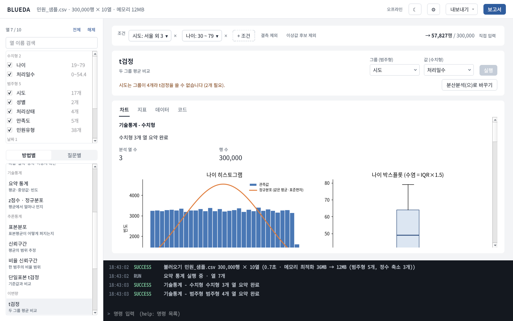

# BLUEDA

데이터를 받으면 전처리가 필요한지부터 판단하고, 분석에 쓴 코드를 목적 → 코드 → 결과 → 해석 순서로 기록하는 EDA 도우미입니다. 공공기관·사기업 데이터를 PC 안에서만 분석하며, 데이터를 외부로 보내지 않습니다.



## 프로그램 실행 (v0.5.2)

```bash
pip install -e ".[gui]"     # 엔진 + 화면(PySide6)
python -m blueda            # 프로그램 창 열기
```

| 화면 | 기능 |
|---|---|
| 시작 | 파일을 끌어다 놓거나 클릭해서 선택 · 형식·인코딩 자동 판별 · 읽기 진행률과 취소 · 메모리가 부족할 것 같으면 일부 열만 읽기 · 최근 파일 |
| 표·차트 만들기 | 피벗 표(행·열·값·집계, 날짜 단위), 교차표(개수·행%·열%·전체%), 차트 6종(막대·선·산점도·히스토그램·상자그림·상관 히트맵). 집계는 전체 데이터, 차트마다 집계표 포함 |
| [!] 이슈 | 파일을 열면 뒤에서 전처리 점검 → 상단에 이슈 수 표시, 누르면 목록과 바로 가기 |
| 조회 히스토리 | 결과 세션 옆 탭. 필터·분석 등을 한 줄씩 기록, 누르면 그때 조건으로 되돌림. 데이터는 저장하지 않고 필터 값은 기본으로 가림 |
| 날짜 변환 | 날짜처럼 보이는 글자 열을 찾아 알려주고, 사용자가 고른 열만 `pd.to_datetime`으로 변환 (나중에 `dates` 명령으로 다시 열기) |
| 왼쪽 | 열 상자(고정 높이 안에서만 스크롤, 검색, 전체/해제, 종류별 묶음, 오른쪽 클릭으로 변수 종류 바꾸기) · 분석 메뉴(방법별/질문별) |
| 조건 줄 | 필터 칩: 범주형은 값 목록(행 수·검색), 수치형·날짜는 범위 · 결측 제외 · 이상값 후보 제외 · 남는 행 수 즉시 표시 · 직접 입력(pandas query) |
| 분석 설정 | 칸마다 맞는 종류의 열만 표시 · 실행 전 점검(예: 그룹이 3개 이상이면 t검정 대신 분산분석 제안) |
| 결과 탭 | 차트 · 지표(표마다 복사·CSV 저장) · 데이터(1,000행씩 이어서 불러오기, 열 이름으로 정렬) · 코드 |
| 결과 세션 | SUCCESS / FAIL / UNSUPPORTED 기록, 줄을 누르면 그 결과를 다시 보기, 명령(help, show, rows, dates, history, clear, theme) |
| 상단 | 라이트/다크 모드 · 설정(유의수준, IQR 배수, \|z\| 기준, 차트 표본 크기 등, PC에 저장) · 내보내기(Excel, CSV, 분석 로그) |

큰 데이터 대응: CSV를 20만 행씩 나눠 읽고, 반복 문자열은 범주형으로 바꿔 메모리를 줄입니다(실수 열은 정밀도를 위해 그대로 둡니다). 분석은 별도 스레드에서 돌아 화면이 멈추지 않습니다. 차트는 행이 많으면 표본(기본 10만 행)으로 그리고, 통계값은 전체 데이터로 계산합니다.

리눅스 테스트 환경에서 가상 데이터 120만 행(68MB, CSV)으로 잰 시간입니다. PC 사양에 따라 다릅니다.

| 단계 | 시간 |
|---|---|
| 파일 읽기 + 메모리 최적화 (144MB → 33MB) | 약 2.7초 |
| 분석 화면 시작 | 약 0.3초 |
| 필터 칩 적용 | 약 0.2초 |
| 분산분석 + 사후검정 + 차트 | 약 0.8초 |

코드 구조와 고칠 곳은 [docs/ARCHITECTURE.md](docs/ARCHITECTURE.md)에 정리했습니다.

변경 내용은 [CHANGELOG.md](CHANGELOG.md)에 버전별로 기록합니다. 각 버전은 Git 태그로 남아 있어 언제든 되돌릴 수 있습니다.

준비 중: 보고서(Word·PDF, 4단계), 표·차트 만들기(피벗 표·교차표·차트), Word·PDF 표 추출, 분석 명령어 해석(5단계), exe 배포(6단계).

## 주요 기능

| 구분 | 기능 | 설명 |
|---|---|---|
| 기본 | A. 전처리 판단 | 타입, 결측, 중복, 이상치, 범주 불일치, 단위를 항상 같은 순서로 점검합니다 |
| 기본 | B. 분석 로그 | 실행한 코드를 한국어 주석과 함께 `.md`와 `.py`로 저장합니다 |
| 기본 | C. 재현성 기록 | 라이브러리 버전, 랜덤 시드, 데이터 경로와 해시를 `.json`으로 남깁니다 |
| 선택 | E. 출처·이용조건 확인 | 데이터 출처와 라이선스를 기록하고 빠진 항목을 알려줍니다 |
| 선택 | F. 통계 가정 점검 | 정규성, 등분산, 상관 중 원하는 검사만 실행합니다 |
| 선택 | G. 학습 개념 연결 | 분석 단계마다 적용한 개념과 출처를 로그에 표시합니다 |

## 분석 엔진 (v0.2.0, 1단계)

공공기관·사기업 데이터를 PC 안에서만 분석하는 것을 목표로 합니다. 모든 처리는 로컬에서 이루어지고 외부로 데이터를 보내지 않습니다.

| 기능 | 설명 |
|---|---|
| 파일 자동 판별 | 확장자와 파일 앞부분(매직 바이트)을 함께 확인합니다. CSV는 인코딩(utf-8, cp949 등)과 구분자를 자동으로 찾습니다. Excel은 시트 목록을 읽습니다. Word·PDF는 형식만 판별합니다 (표 추출은 5단계) |
| 분석 범위 지정 | 열 선택, 행 조건(`나이 >= 30`), 행 구간, 결측 행 제외. 원본 데이터는 바뀌지 않습니다 |
| 변수 종류 판정 | 열마다 수치형·범주형·날짜·ID 후보·텍스트를 판정합니다. `1=남, 2=여`처럼 숫자로 적힌 범주를 경고하고, 사용자가 직접 바꿀 수 있습니다 |
| 분석 단위 확인 | "한 행 = 고객 1명"처럼 단위를 정하고, 기준 열에 중복이 있는지 확인합니다 |
| 기술통계 | 수치형(평균·중앙값·표준편차·사분위수·왜도·첨도), 범주형(빈도·비율·최빈값), 히스토그램(정규분포 곡선 겹침)·박스플롯·빈도 막대 |
| z점수 | (값 − 평균) ÷ 표준편차로 표준화하고, \|z\| > 3(설정 가능)인 값을 이상값 후보로 표시합니다 |
| 결과 세션 | 모든 분석은 `[SUCCESS]` / `[FAIL]` / `[UNSUPPORTED]` 한 줄로 기록됩니다. 실패해도 프로그램이 멈추지 않습니다 |
| 미지원 기능 알림 | 아직 없는 분석을 요청하면 필요한 기능과 필요한 학습 내용을 보여주고 `update_requests.csv`에 기록합니다 |
| 내보내기 | Excel(요약·표·차트 시트), CSV(표별 파일, 엑셀 한글 호환) |

```python
from blueda import Blueda

bd = Blueda.from_file("data/매출.csv")             # 형식·인코딩 자동 판별
bd.set_scope(columns=["지역", "매출"], query="나이 >= 30")
bd.describe()                                       # 기술통계 + 차트
bd.request("anova", "지역별 매출 차이")              # 미지원 → 알림 + 요청 기록
Blueda.capabilities()                               # 전체 기능 목록과 개발 단계
bd.export_excel()
```

예제: `python examples/engine_demo.py`

## 통계 분석 (v0.3.0, 2단계)

모든 검정은 귀무가설·대립가설, p값 해석 문장, 효과 크기, 전제 조건 점검(정규성·등분산·기대빈도)을 함께 보여줍니다.

| 학습 영역 | 기능 | 메서드 |
|---|---|---|
| 추론통계 | 표본분포 시뮬레이션 (중심극한정리, 표준오차 σ/√n 비교) | `sampling_distribution(열)` |
| 추론통계 | 평균 신뢰구간 (t분포), 비율 신뢰구간 (Wilson) | `confidence_interval(열)`, `confidence_interval(열, category="Y")` |
| 추론통계 | 단일표본 t검정 | `one_sample_ttest(열, mu0)` |
| 이변량 (범주×수치) | 독립표본 t검정 (등분산 검정으로 Student/Welch 자동 선택, Cohen's d) | `t_test(그룹열, 값열)` |
| 이변량 (범주×수치) | 일원분산분석 ANOVA (η², 유의하면 Tukey HSD 사후검정) | `anova(그룹열, 값열)` |
| 이변량 (범주×범주) | 교차표·카이제곱 (Cramér's V, 기대빈도 부족 시 Fisher 정확검정) | `chi_square(열1, 열2)` |
| 이변량 (수치×수치) | 상관 검정 (Pearson·Spearman + p값), 단순회귀 (잔차 그림) | `correlation_test(x, y)`, `simple_regression(x, y)` |
| 다변량 | 다중회귀 (범주형 자동 더미, 수정 R², VIF 다중공선성) | `multiple_regression(y, [x1, x2, ...])` |

유의수준은 `BluedaConfig(alpha=0.05)`에서 바꿀 수 있습니다. 결과값은 테스트에서 scipy·statsmodels로 직접 계산한 값과 대조해 검증합니다.

예제: `python examples/stage2_demo.py`

사용 라이브러리: pandas, NumPy, SciPy, statsmodels, Matplotlib, seaborn, openpyxl (모두 BSD 계열 또는 MIT 라이선스)

## 설치 (VS Code)

1. 이 폴더를 VS Code로 엽니다. 추천 확장(Python, Jupyter) 설치 알림이 뜨면 설치합니다.
2. 터미널(`Ctrl + ~`)에서 가상환경을 만들고 켭니다.

   ```bash
   # Windows
   python -m venv .venv
   .venv\Scripts\activate

   # macOS / Linux
   python3 -m venv .venv
   source .venv/bin/activate
   ```

3. 패키지를 설치합니다. `-e`는 코드를 고치면 바로 반영되는 개발용 설치입니다.

   ```bash
   pip install -r requirements.txt
   pip install -e .
   ```

4. `Ctrl + Shift + P` → `Python: Select Interpreter` → `.venv`를 선택합니다.
5. 예제를 실행해 봅니다.

   ```bash
   python examples/quickstart.py
   pytest
   ```

## 사용법

```python
from blueda import Blueda, BluedaConfig

config = BluedaConfig(
    check_source_license=True,                  # E
    stat_checks=["normality", "correlation"],   # F: 원하는 검사만
    link_lecture_concepts=True,                 # G
)

bd = Blueda.from_csv("data/my_data.csv", config=config)
bd.check()                          # A: 전처리 판단
bd.set_source(name="...", provider="...", url="...", license="공공누리 1유형", checked_date="2026-11-20")
step = bd.run("지역별 평균", 'print(df.groupby("region")["score"].mean())')
bd.stats(columns=["age", "score"])  # F
bd.save()                           # logs/ 폴더에 저장
```

정식 배포용으로 쓸 때는 `release_config()`로 시작하면 G가 꺼진 상태가 됩니다.

## 폴더 구조

```
blueda/            패키지 본체
examples/          사용 예제
tests/             기능 테스트 (pytest)
logs/              분석 로그 저장 위치 (GitHub에는 올라가지 않음)
data/              원본 데이터 위치 (GitHub에는 올라가지 않음)
```

## 주의사항

- 전처리 판단은 의심 신호를 알려주는 기능입니다. 처리 방법은 결과를 보고 직접 결정해야 합니다.
- 라이선스는 자동으로 확인할 수 없습니다. 데이터 제공처의 원문 조건을 직접 확인해 주세요.
- 상관관계는 인과관계가 아닙니다.
